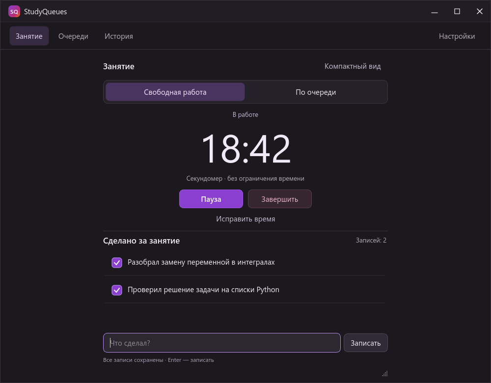
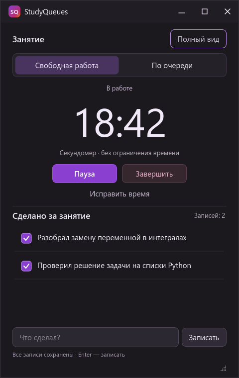

# «Занятие в центре»: результат проверки

1 ноября 2026. Реализован выбранный вариант и открыт штатным запуском StudyQueues на рабочем профиле. Главное окно находится на вспомогательном мониторе; прежнее занятие восстановлено на паузе. Исходники изменены локально, без публикации.

## Рабочий сценарий

Главный экран — «Занятие». Видны оба режима. Свободная работа начинается пустой после «Начать», считает вверх и принимает только собственные записи. В очереди сначала выбираются очередь, начальная задача и длительность; затем отдельное «Начать». Крупное время — оставшееся, подпись — отработанное. Пауза, исправление времени и завершение находятся рядом со временем. Полный и компактный вид используют один экран занятия и одно нативное окно. Очереди, история и настройки доступны в верхней навигации полного вида.

### Реальные снимки приложения на демонстрационных данных

Состояния подготовки, пустого занятия, очереди, паузы, восстановления, коррекции и результата сохранены в `C:/Base/personalization/studyqueues-center-2026-11-01/qa/screens-1/`. Это снимки Qt-виджетов работающего приложения, не проектные макеты. Снимки настоящего рабочего окна: `qa/native-full.png` и `qa/native-compact.png`; они остаются вне репозитория, поскольку содержат личные задачи.

## Фактически пройденные действия

| Критерий | Проверка и результат |
| --- | --- |
| 25 минут не запускают занятие | Нажаты «По очереди», 60, затем 25 минут, выбрана другая стартовая задача. Активного занятия и новой истории нет. Только «Начать» создаёт занятие на 1500 секунд с выбранной задачи. |
| Свободная работа без очередей | В профиле заранее есть очередь с задачами и подпунктами. Нажат «Начать» свободной работы: список записей пуст, размер окна не меняется, план времени равен нулю. |
| Записи сохраняются | Введены две записи, добавлен черновик, выполнены переключения вида. Окно закрыто и создано заново на том же отдельном профиле: сохранены записи, черновик, ID занятия и время; занятие на паузе. |
| Пауза и коррекция | После 18:42 работы исключены пять минут через диалог с предварительным итогом. Получено 13:42, режим остался на паузе. Для очереди проверено увеличение оставшегося времени после поправки. |
| Завершение | Непустой ввод занятия сохранён в итог; отдельный черновик каталога не включён. После повторного открытия активного занятия и предложения восстановить завершённое нет. Ошибка записи оставляет незавершённое занятие доступным. |
| Смена режима | «Остаться» сохраняет активное занятие, текст и правильное выделение режима. «Завершить и перейти» сохраняет запись и открывает подготовку очереди без запуска. |
| Работа по очереди | Проверены выполнение с подпунктами, пропуск без отметки, отмена и конец очереди. Просмотр другого проекта не меняет текущую задачу. Ноль времени не завершает занятие автоматически. |
| Одно окно | QtTest проверяет неизменность winId. В настоящем приложении полный → компактный → полный вид сохранили HWND 1443048; инвентарь Windows показывает одно окно StudyQueues. |
| Размеры и текст | Проверены полный вид 1000×780, компактный 480×760 и граничные 440×640 / 700×900. Длинное содержимое прокручивается; время и основные действия остаются доступны. Найденные наложения времени и неверная высота длинного заголовка исправлены и перепроверены. |
| Переходы | Пройдены повторные переходы по разделам с 400 задачами и действующим занятием; цикл Qt продолжает обрабатывать события, ошибок не зарегистрировано. Сообщённое пользователем прежнее зависание не воспроизведено; устранение всех возможных его причин не утверждается. |

Оба режима видны без меню. Это проверено по реальному экрану; самостоятельное обнаружение режимов новым пользователем в отдельном исследовании не проверялось.

Полный pytest: **202 прошли**. Дополнительно 37 проверок нового сценария и рабочего UI прошли при каждом масштабе 150% и 200%; снимки проверены визуально. Логи: `qa/pytest-accepted.txt`, `qa/pytest-scale150.txt`, `qa/pytest-scale200.txt`. Сценарий снимков с фактическими кликами, коррекцией и перезапуском: `qa/render-center.py`; результаты — `screens-*/report.json`.

## Сохранность рабочего профиля

До запуска новой версии создана согласованная SQLite-копия через backup API: `C:/Base/personalization/studyqueues-center-2026-11-01/before/workspace.sqlite3`.

После запуска и переключений вида сравнены хеши таблиц задач, проектов, записей, связей, поправок и прочих рабочих таблиц, вся завершённая история, ID, накопленное время и интервалы активного занятия. Изменений нет: **408 задач, 12 занятий**. Проверки SQLite integrity_check и foreign_key_check прошли. Результат: `C:/Base/personalization/studyqueues-center-2026-11-01/data-verification.json`.

В настоящем профиле проверялось восстановление и переключение вида; искусственные записи, завершения и поправки в нём не создавались. Полный сценарий выполнялся на отдельном тестовом профиле. Рабочее приложение оставлено открытым на паузе.
